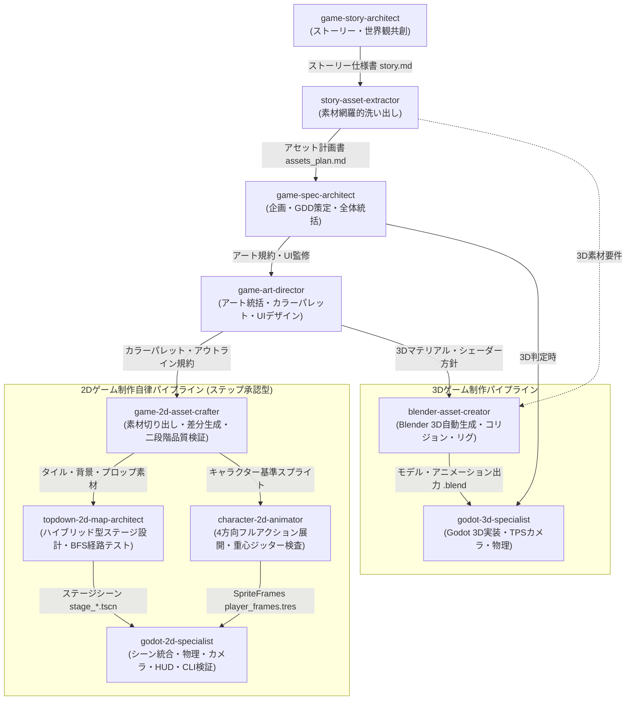

# Godot Game Development Skills Suite

Godot 4.x および Blender 5.2 を活用したゲーム開発を自律的かつ体系的に推進するための Antigravity 専用スキルスイートです。

ストーリー・世界観の共創、物語起点のアセット網羅的洗い出し、ゲーム仕様策定（GDD）、アートディレクション、2Dゲーム向け素材抽出・自律品質検証・ステージ自動構築・4方向アクションアニメーション生成、そしてGodot 2D/3Dエンジン実装まで、各工程に特化したスキル群が有機的に連携して高品質なゲーム制作を一気通貫で支援します。

---

## 収録スキル一覧（全10スキル）

| スキル名 | ディレクトリ | 役割・概要 |
| :--- | :--- | :--- |
| **game-story-architect** | `game-story-architect/` | 段階的ヒアリングを通じて魅力的なゲームストーリー、世界観設定、キャラクター、ステージ連動プロットを共創する親オーケストレータースキル。 |
| **story-asset-extractor** | `story-asset-extractor/` | 確定したストーリーから制作に必要な全素材（キャラ、背景、アイテム、サウンド、UI）を洗い出し、2D/3D対応アセットマトリクスを作成するスキル。 |
| **game-spec-architect** | `game-spec-architect/` | ゲーム企画の壁打ち・要件定義からMVP仕様書（GDD）策定、タスク分解までをヒアリング主導で推進する親オーケストレータースキル。 |
| **game-art-director** | `game-art-director/` | ゲーム全体のビジュアル調和、カラーパレット、UI/HUDデザイン、質感を統括し、AI特有の安易な絵文字多用やチープなデザインを排除・監修するアートディレクションスキル。 |
| **game-2d-asset-crafter** | `game-2d-asset-crafter/` | デザインイメージからキャラクター、タイル、アイテム、UI素材を透過切り出し・AI補完生成し、二段階品質検証（パレット・透過境界・規格）で合格まで自律リトライする2D素材制作スキル。 |
| **topdown-2d-map-architect** | `topdown-2d-map-architect/` | 抽出タイル素材からハイブリッド型（設計＋自動接続）でステージを構築し、構成の崩れ（BFS経路探索100%保証）およびデザインの崩れ（タイル接続・壁内埋没）を自動検証してGodot TileMapLayerを出力するスキル。 |
| **character-2d-animator** | `character-2d-animator/` | 基準スプライトから4方向（正面/背面/左右）フルアクションアニメーション（待機・歩行・ダッシュ・弱攻撃・強攻撃・被弾・死亡）を展開し、重心ジッター検査・ループGIF生成・Godot SpriteFramesを出力するスキル。 |
| **godot-2d-specialist** | `godot-2d-specialist/` | Godot 4.xでの2Dゲーム開発オーケストレーター。上記2D制作スキル群の成果物（TileMapLayer, SpriteFrames）を統合し、物理、ステートマシン、カメラ、UI、オーディオ、およびCLI自動検証を統括。 |
| **godot-3d-specialist** | `godot-3d-specialist/` | Godot 4.xでの3Dゲーム（3Dアクション、TPS等）開発オーケストレーター。CharacterBody3D、三人称追従カメラ、3D物理、Blender統合、3D VFX・音響を統括。 |
| **blender-asset-creator** | `blender-asset-creator/` | Blender 5.2を活用し、Pythonスクリプトによるヘッドレス3D自動モデリング・マテリアル・アニメーション・Godot用自動コリジョン生成を行うアセットオーケストレータースキル。 |

---

## 全体連携アーキテクチャ & 依存関係



---

## 2Dゲーム制作統合パイプラインの各スキル詳細

### 1. game-2d-asset-crafter (素材制作・自律反復検証)
- **概要**: 提示されたデザインイメージ（一枚絵等）からパーツを切り出し、背景透過処理や不足素材の補完生成を行い、元デザインとの整合性をテストしてスプライトシート化します。
- **付属スクリプト**:
  - `scripts/extract_segments.py`: バウンディングボックスクロップ、四隅自動色推定による背景透過、オートクロップ、等倍グリッド配置（Nearest Neighborリサイズ）。
  - `scripts/validate_sprite_quality.py`: パレット類似度（閾値60%以上）、アルファ透過フリンジ/半透明ピクセル率（5%未満）、グリッド規格を自動検証（JSONレポート出力）。
  - `scripts/pack_spritesheet.py`: 個別透過PNGを等幅グリッドスプライトシートに結合し、Godot/Phaser向けメタデータJSONを出力。
- **後続連携**:
  - タイル素材を `topdown-2d-map-architect` へ引き渡し。
  - キャラクター基準素材を `character-2d-animator` へ引き渡し。

### 2. topdown-2d-map-architect (ステージ設計・自律検証)
- **概要**: 抽出されたタイルから、ユーザーのイメージの有無に応じたハイブリッド型（主要地点固定＋通路自動接続）でステージを設計し、二大自動テストに合格するまで自律修正します。
- **二大自動テスト**:
  - **構成の崩れテスト (`scripts/validate_map_structure.py`)**: BFS（幅優先探索）により、スタート地点からゴール（Exit）および全宝箱への移動経路が100%確保されているかを検証。外周の密閉壁漏れ、孤立床を排除。
  - **デザインの崩れテスト (`scripts/validate_map_design.py`)**: 孤立した1マス壁、壁で囲まれた1マス床穴、壁内部への小道具（松明等）の誤埋没を検出。
- **付属スクリプト**:
  - `scripts/build_topdown_map.py`: ハイブリッド型マップ構築、全体俯瞰プレビューPNGレンダリング、Godot 4.x TSCNエクスポート。
- **後続連携**:
  - 生成されたステージシーン（`stage_*.tscn`）を `godot-2d-specialist` のレベル担当へ引き渡し。

### 3. character-2d-animator (4方向アニメーション展開・自律検証)
- **概要**: 抽出された基準キャラから、4方向（正面/背面/左右）に対応したフルアクション（待機・歩行・ダッシュ・弱攻撃・強攻撃・被弾・死亡）のコマ展開を行い、フレーム間のブレを自動検証してGodotリソースを出力します。
- **フルアクション7大ステート**:
  - `Idle`: 2〜4コマ、穏やかな呼吸による上下動（ループ）
  - `Walk`: 4〜6コマ、腕振り・足踏み・接地感の維持（ループ）
  - `Dash`: 2〜4コマ、前傾姿勢と推進力（ループ）
  - `Light Attack`: 3〜4コマ、短い予備動作と鋭い素振り（ワンショット）
  - `Heavy Attack`: 5〜6コマ、溜めと力強い振り下ろし（ワンショット）
  - `Hurt`: 2〜3コマ、のけぞり・ノックバック（ワンショット）
  - `Death`: 4〜6コマ、倒れ込み・消滅演出（停止）
- **付属スクリプト**:
  - `scripts/validate_animation.py`: フレーム間の重心ジッター（3.5px以内）、シルエット体積ブレ（±25%以内）、ループ接続跳躍の自動検査。
  - `scripts/render_anim_preview.py`: 3倍Nearest拡大を適用した透過ループプレビューGIFおよび横並びフィルムストリップ画像生成。
  - `scripts/export_godot_spriteframes.py`: Godot 4.x の `SpriteFrames` リソース（`.tres`）を自動エクスポート。
- **後続連携**:
  - 生成された `player_frames.tres` を `godot-2d-specialist` のロジック担当へ引き渡し。

### 4. godot-2d-specialist (ゲームシーン統合・CLI自律検証)
- **概要**: 上記スキル群からステージ（`stage_*.tscn`）とキャラクターアニメーション（`SpriteFrames`）を集約し、`CharacterBody2D` に4方向ステートマシンを実装。カメラ追従、HUD、VFXを組み込み、Godot CLI自動検証を経てプレイ可能なゲームとして完成させます。

---

## 導入方法

Antigravity のスキルディレクトリ（通常は `~/.gemini/config/skills/`）に対象のスキルフォルダを配置することで利用可能になります。

```bash
# スキルディレクトリへの配置例
cp -r game-story-architect ~/.gemini/config/skills/
cp -r story-asset-extractor ~/.gemini/config/skills/
cp -r game-spec-architect ~/.gemini/config/skills/
cp -r game-art-director ~/.gemini/config/skills/
cp -r game-2d-asset-crafter ~/.gemini/config/skills/
cp -r topdown-2d-map-architect ~/.gemini/config/skills/
cp -r character-2d-animator ~/.gemini/config/skills/
cp -r godot-2d-specialist ~/.gemini/config/skills/
cp -r godot-3d-specialist ~/.gemini/config/skills/
cp -r blender-asset-creator ~/.gemini/config/skills/
```
