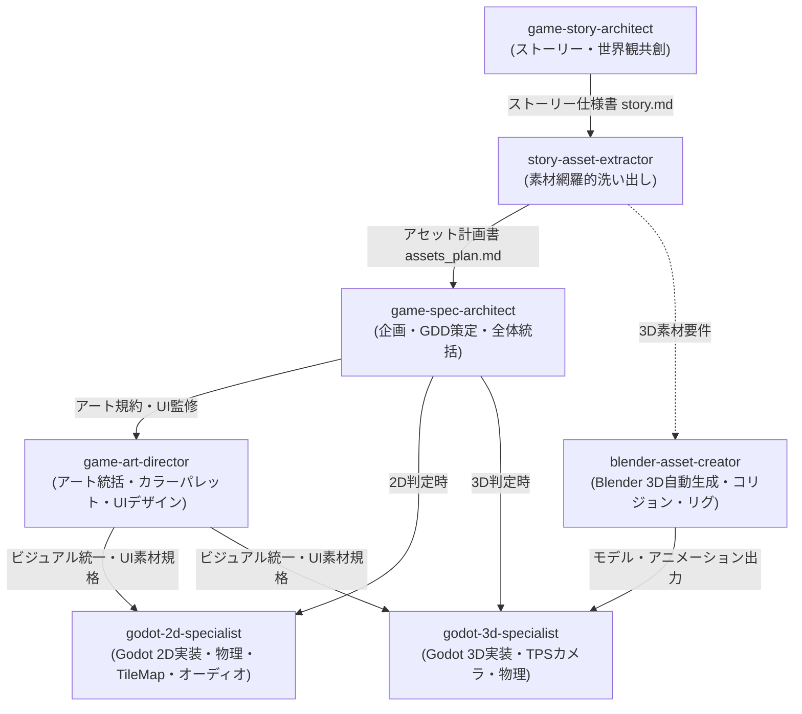

# Godot Game Development Skills Suite

Godot 4.x および Blender 5.2 を活用したゲーム開発を自律的かつ体系的に推進するための Antigravity 専用スキルスイートです。

ストーリー・世界観の共創、物語起点のアセット網羅的洗い出し、ゲーム仕様策定（GDD）、アートディレクション、2D/3Dエンジン実装、3Dアセット自動生成まで、各工程に特化したスキル群が有機的に連携して高品質なゲーム制作を支援します。

---

## 収録スキル一覧

| スキル名 | ディレクトリ | 役割・概要 |
| :--- | :--- | :--- |
| **game-story-architect** | `game-story-architect/` | 段階的ヒアリングを通じて魅力的なゲームストーリー、世界観設定、キャラクター、ステージ連動プロットを共創する親オーケストレータースキル。 |
| **story-asset-extractor** | `story-asset-extractor/` | 確定したストーリーから制作に必要な全素材（キャラ、背景、アイテム、サウンド、UI）を洗い出し、2D/3D対応アセットマトリクスを作成するスキル。 |
| **game-spec-architect** | `game-spec-architect/` | ゲーム企画の壁打ち・要件定義からMVP仕様書（GDD）策定、タスク分解までをヒアリング主導で推進する親オーケストレータースキル。 |
| **game-art-director** | `game-art-director/` | ゲーム全体のビジュアル調和、カラーパレット、UI/HUDデザイン、質感を統括し、AI特有の安易な絵文字多用やチープなデザインを排除・監修するアートディレクションスキル。 |
| **godot-2d-specialist** | `godot-2d-specialist/` | Godot 4.xでの2Dゲーム（プラットフォーマー、トップダウン等）開発オーケストレーター。CharacterBody2D物理、ステートマシン、TileMapLayer、VFX、オーディオ管理を統括。 |
| **godot-3d-specialist** | `godot-3d-specialist/` | Godot 4.xでの3Dゲーム（3Dアクション、TPS等）開発オーケストレーター。CharacterBody3D、三人称追従カメラ、3D物理、Blender統合、3D VFX・音響を統括。 |
| **blender-asset-creator** | `blender-asset-creator/` | Blender 5.2を活用し、Pythonスクリプトによるヘッドレス3D自動モデリング・マテリアル・アニメーション・Godot用自動コリジョン生成を行うアセットオーケストレータースキル。 |

---

## 連携ワークフロー



### 開発フロー詳細

1. **ストーリー共創フェーズ (`game-story-architect`)**:
   - ユーザーへの段階的ヒアリング（世界観・キャラクター・起承転結プロット）を行い、`story.md` を策定します。
2. **アセット洗い出しフェーズ (`story-asset-extractor`)**:
   - ストーリーを解析し、キャラクター、背景、プロップ、BGM/SE、UI演出の全アセットを抽出して `assets_plan.md` を生成します。
3. **ゲーム仕様策定フェーズ (`game-spec-architect`)**:
   - コアループ、ゲームプレイ、勝利/敗北条件を明確化し、MVP仕様書（GDD）とタスクリストを策定します。
4. **アートディレクションフェーズ (`game-art-director`)**:
   - ビジュアルトーン、カラーパレット（60-30-10原則）、フォント規約、HUDレイアウト基準を確定し、絵文字を排除したUIを構築します。
5. **アセット生成フェーズ (`blender-asset-creator`)**:
   - 3Dゲームの場合、Blender Pythonを活用してローポリ3Dモデル、マテリアル、リグ、アニメーション、およびGodot用コリジョン（`-col`）を自動生成します。
6. **エンジン実装フェーズ (`godot-2d-specialist` / `godot-3d-specialist`)**:
   - Godot 4.x のノード構造、型付けされたGDScript、ステートマシン、物理挙動、オーディオ・VFX、CLI自動検証（ヘッドレス構文チェック）を実装・統括します。

---

## 内蔵サブエージェント一覧（全23種）

各親スキルは、専門タスクに特化した自律サブエージェントをディスパッチして分業を推進します。

### 1. game-story-architect（ストーリー共創）
- **`story-world-builder`**: 世界観・時代背景・魔法/科学法則・地理・対立構造の構築。
- **`story-character-profiler`**: 主人公・敵ボス・NPCの性格、動機、口調、ビジュアル特徴定義。
- **`story-plot-pacing`**: 各ステージのゲームプレイと連動した起承転結プロットの設計。

### 2. story-asset-extractor（素材洗い出し）
- **`asset-visual-extractor`**: 物語からキャラクター、背景、プロップのビジュアル仕様を抽出。
- **`asset-audio-extractor`**: シーンの感情トーンやテンポに応じたBGM・効果音・環境音仕様を抽出。
- **`asset-matrix-formatter`**: 2D/3D両対応のアセット計画マトリクス（優先度・担当スキル連動）を整形。

### 3. game-spec-architect（企画・要件定義）
- **`spec-interviewer`**: ユーザーと段階的対話を行い、ゲームの次元・コアループ・勝利条件をヒアリング。
- **`spec-task-decomposer`**: 確定した仕様からMVPスコープのTODOタスクリストを作成。
- **`spec-asset-analyzer`**: 必要なスプライト、3Dモデル、BGM、SE、UI素材を洗い出し。

### 4. game-art-director（アートディレクション）
- **`palette-typo-specialist`**: 60-30-10比率によるカラーパレット（HEX）およびタイポグラフィ規格策定。
- **`ui-style-specialist`**: 絵文字を完全排除したベクター/テクスチャHUD、ライフバー、ダイアログ設計。
- **`vfx-shader-specialist`**: パーティクル（煙・火花・光芒）およびマテリアル質感（ラフネス・メタリック）の統一。

### 5. godot-2d-specialist（Godot 2D実装）
- **`2d-logic-specialist`**: `CharacterBody2D` の物理挙動、ステートマシン、入力系実装。
- **`2d-level-specialist`**: `TileMapLayer`、足場・障害物配置、`Camera2D` スムージング制御。
- **`2d-ui-specialist`**: アート規約に準拠したベクターHUD、ライフバー、ポーズ画面実装。
- **`2d-vfx-audio-specialist`**: `CPUParticles2D`（土煙、光芒）およびオーディオプール管理。

### 6. godot-3d-specialist（Godot 3D実装）
- **`3d-logic-specialist`**: `CharacterBody3D`、三人称追従カメラ（`SpringArm3D` + `Camera3D`）、3Dステートマシン。
- **`3d-level-specialist`**: `.blend` モデル（`-col` 自動コリジョン）の配置、ライティング（影設定）。
- **`3d-ui-specialist`**: 3D空間と調和するモダンなCanvasLayer HUD、リザルト画面。
- **`3d-vfx-audio-specialist`**: `GPUParticles3D`（衝撃波・煙・火花）および3D位置音響制御。

### 7. blender-asset-creator（Blender 3D制作）
- **`blender-mesh-specialist`**: Python（`bpy`）によるメッシュ自動生成、原点接地、スケール適用。
- **`blender-mat-specialist`**: カラーパレットに基づくPrincipled BSDFマテリアル設定。
- **`blender-rig-anim-specialist`**: 回転・浮遊・開閉アニメーションおよびボーンリグ構築。

---

## 導入方法

Antigravity のスキルディレクトリ（通常は `~/.gemini/config/skills/`）に対象のスキルフォルダを配置することで利用可能になります。

```bash
# 例: スキルディレクトリへの配置
cp -r game-story-architect ~/.gemini/config/skills/
cp -r story-asset-extractor ~/.gemini/config/skills/
cp -r game-spec-architect ~/.gemini/config/skills/
cp -r game-art-director ~/.gemini/config/skills/
cp -r godot-2d-specialist ~/.gemini/config/skills/
cp -r godot-3d-specialist ~/.gemini/config/skills/
cp -r blender-asset-creator ~/.gemini/config/skills/
```
