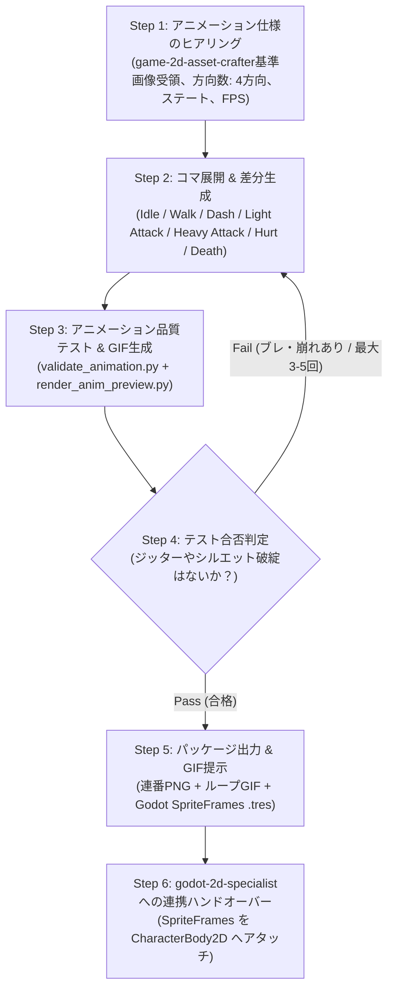

# Character 2D Animator (2Dキャラアニメーション制作＆自律検証オーケストレーター)

基準スプライト（プレイヤー、敵モブ、NPC）から、4方向（正面/背面/左右）に対応したフルアクション（待機・歩行・ダッシュ・弱攻撃・強攻撃・被弾・死亡）のコマ展開を行い、**「フレーム間の重心ジッター」** と **「頭身・体積ブレ」** を自動検証して、滑らかなプレビューGIFとGodot 4.x用リソースを出力するスキルです。

---

## ワークフロー概要

---

## ワークフローステップ詳細

### Step 1: アニメーション仕様のヒアリング
- `game-2d-asset-crafter` 等から基準スプライトを受領し、キャラ種別（プレイヤー/敵/NPC）、生成ステート（待機・歩行・ダッシュ・弱攻撃・強攻撃・被弾・死亡）、4方向（down/up/left/right）を確認します。

### Step 2: コマ展開 & 差分生成
- 重心の上下動（Bobbing）、腕振り、足踏み、攻撃のタメ・フォロースルーを付与した各フレームを生成し、等倍セルPNGとして保存。

### Step 3: アニメーション品質テスト & GIF生成
1. **重心ジッター・シルエット体積ブレ検査**: `scripts/validate_animation.py` で重心ブレ（3.5px以下）、シルエット面積（±25%以内）、ループ接続性を検証。
2. **ループプレビューGIFの生成**: `scripts/render_anim_preview.py` でNearest Neighbor拡大を適用したループGIFを生成。

### Step 4: 改善ループ（反復リトライ）
- ブレ検知時は該当フレームを特定し、補正して Step 2 を再実行（最大3〜5回）。

### Step 5: パッケージ出力 & 節目確認
- **ループ再生GIF** を提示し、ユーザーの承認を得ます（**節目確認 2B**）。
- `scripts/export_godot_spriteframes.py` で Godot 4.x の `SpriteFrames` リソース（`.tres`）をエクスポート。

### Step 6: `godot-2d-specialist` への連携ハンドオーバー
- 承認された `SpriteFrames`（`.tres`）を **`godot-2d-specialist`** のロジック担当サブエージェント（`2d-logic-specialist`）へ引き渡し、`CharacterBody2D` へのアタッチと4方向入力ステートマシンの実装を依頼します。

---

## 付属スクリプト一覧
- **`scripts/validate_animation.py`**: アニメーションフレームの重心ジッター、体積ブレ、ループ整合性の自動テスト
- **`scripts/render_anim_preview.py`**: 透過対応ループプレビューGIFおよびフィルムストリップ画像生成
- **`scripts/export_godot_spriteframes.py`**: Godot 4.x の `SpriteFrames` リソース（`.tres`）自動生成
