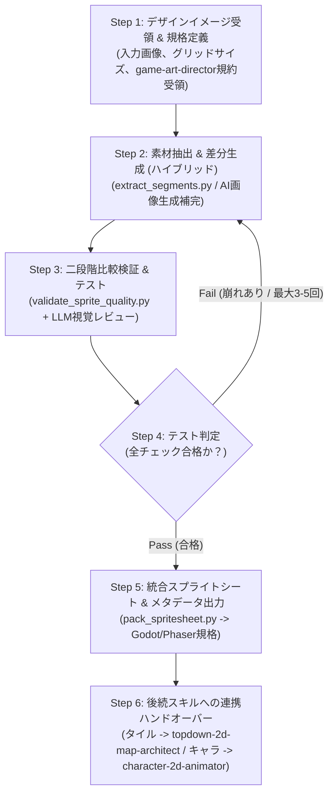

# Game 2D Asset Crafter (2D素材制作・自律反復検証オーケストレーター)

ユーザーから提示されたデザインイメージ（一枚絵・コンセプトアート等）を元に、2Dゲーム用スプライト素材の抽出・生成・品質比較・テスト・スプライトシート化を自律的に繰り返して仕上げるスキルです。

---

## ワークフロー概要

---

## ワークフローステップ詳細

### Step 1: デザインイメージ受領 & 規格定義
1. **ユーザー入力・規約の確認**:
   - デザインイメージ画像ファイル（PNG/JPG等）のパス、または生成済みコンセプトアートを取得。
   - `game-art-director` によるカラーパレット・アウトライン規約が策定されている場合は、そのパラメータをロード。
   - 作成対象（プレイヤー、敵、アイテム、タイルセット等）を確認。
2. **規格策定**:
   - セルグリッドサイズ（16x16, 24x24, 32x32, 48x48, 64x64 等）を決定。

---

### Step 2: 素材抽出 & 差分生成（ハイブリッド方式）
1. **元画像からのパーツ切り出し・背景透過**:
   - `scripts/extract_segments.py` を実行して、元画像から指定パーツを切り抜き、背景色を透過・オートクロップしてグリッドサイズにフィッティングします。
2. **不足素材・アニメーション差分のAI補完生成**:
   - 元画像に含まれていないモーション差分やアイテム等を、トーン＆マナーを保持して画像生成サブエージェント等で生成し、規格化します。

---

### Step 3: 二段階比較検証 & テスト（合否判定）
1. **Stage 1: スクリプト自動検査（定量的テスト）**:
   - `scripts/validate_sprite_quality.py` を実行し、パレット一致率・透過境界フリンジ・グリッド規格を検証します。
2. **Stage 2: LLM視覚レビュー（定性的テスト）**:
   - `references/quality_criteria.md` の基準に基づき、頭身比・アウトライン・アートスタイルの調和を対比確認します。

---

### Step 4: 改善ループ（反復リトライ）
- **Failの場合**: 原因を特定し、パラメータ調整またはAIプロンプト補正を行って Step 2 へ戻り再実行（最大3〜5回）。
- **Passの場合**: Step 5 へ進行。

---

### Step 5: 統合スプライトシート & メタデータ出力
- `scripts/pack_spritesheet.py` を実行してスプライトシートおよびアトラスJSONを出力。
- ユーザーへ素材一覧を提示し、承認を得ます（**節目確認 1**）。

---

### Step 6: 後続スキルへの連携（ハンドオーバー）
ユーザー承認後、抽出された素材の用途に応じて後続の専門スキルを自動起動します：
1. **タイル・背景・プロップ素材**:
   - **`topdown-2d-map-architect`** を呼び出し、ステージ・マップの構築工程へ移行。
2. **キャラクター基準スプライト**:
   - **`character-2d-animator`** を呼び出し、4方向フルアクションアニメーションの制作工程へ移行。

---

## 付属スクリプト一覧
- **`scripts/extract_segments.py`**: バウンディングボックスクロップ、背景透過、オートクロップ、等倍グリッド配置
- **`scripts/validate_sprite_quality.py`**: パレット類似度計算、アルファ半透明/フリンジ検出、グリッド規格判定
- **`scripts/pack_spritesheet.py`**: 個別PNGからのスプライトシート結合、Godot/Phaser向けメタデータJSON生成
