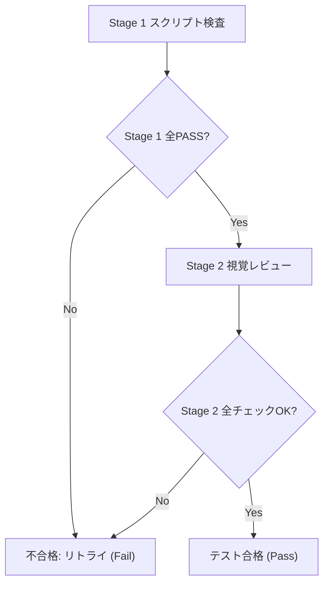

# 2Dスプライト品質検証・合否判定基準ガイド

本ドキュメントは、抽出・生成された2Dゲーム素材が、元のデザインイメージの品質およびトンマナ（トーン＆マナー）を維持しているかを評価するためのテスト基準を定めます。

---

## 1. 定量検査基準（Stage 1: スクリプト自動検査）

`validate_sprite_quality.py` により客観的・自動的に検査されるメトリクスです。

| 検査項目 | 合格基準 (Threshold) | 不合格となる主な要因 | 改善アクション |
| :--- | :--- | :--- | :--- |
| **パレット一致率** | **60%以上** (推奨80%以上) | 元画像と異なる色相の混入、不要なグラデーション | 生成プロンプトのカラーパレット指定補正、減色処理 |
| **透過境界 (Alpha)** | 半透明ピクセル率 **5%未満** | 背景切り抜き時の白いフリンジ、アンチエイリアスの残り | 切り抜き閾値(tolerance)の調整、境界の2値化クリーン |
| **グリッド規格** | 指定サイズ（またはその整数倍）と完全一致 | ピクセルが中途半端にトリミングされている | `fit_to_grid` による規定セルへの自動パディング配置 |

---

## 2. 定性検査基準（Stage 2: LLMマルチモーダル視覚レビュー）

LLMが元画像とスプライト画像を並べて視覚的に比較し、以下のチェックリストを判定します。

### チェックリスト
1. **アートスタイルの忠実性**:
   - ピクセルアート（ドット絵）の硬さ・粒感が元画像と一致しているか？（ぼやけたブラシストロークやイラスト調の混入がないか）
   - 光源・陰影の付け方（ハイライト、シャドウのコントラスト）が統一されているか？
2. **キャラクターのプロポーション（頭身比）**:
   - 元画像が2頭身（デフォルメ）の場合、抽出・生成素材も厳密に2頭身を維持しているか？
   - 手足の長さや胴体のバランスが崩れていないか？
3. **アウトライン（輪郭線）の一貫性**:
   - 1ピクセル幅の黒・濃色アウトラインがある場合、すべての素材で均一に維持されているか？
   - 輪郭線が途切れたり、部分的に二重線（ダブリング）になっていないか？
4. **Mixels（ピクセルサイズの不揃い）の排除**:
   - キャラクターの一部（目や武器など）だけドットが細かくなっていないか？

---

## 3. 合否判定とリトライループの判断フロー

### リトライ時の修正指針
- **透過ゴミ・境界不良の場合**:
  - `extract_segments.py` の `--tolerance` を上下（20〜45）に調整して再実行。
  - 必要に応じて `--bg-color` を明示指定。
- **スタイル・頭身崩れの場合**:
  - 差分生成時のプロンプトに「Maintain strict 2-head-tall chibi proportions, 1px solid dark outline, 16-bit pixel art style, no anti-aliasing」等の制約を追加。
- **最大リトライ回数**: 3〜5回に達した場合は、現状の最高スコア版を提示し、ユーザーにフィードバックを仰ぐ。

