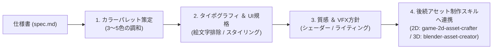

# Game Art Director (ゲームアートディレクション ＆ デザイン統括)

ゲーム全体の美観・調和を監督し、**「AIにありがちなチープな絵文字多用・安易な原色ベタ塗り」を厳格に禁止**して、商業水準の洗練されたゲーム体験をデザインするスキルです。

---

## ワークフロー

---

## 遵守すべき3大鉄則

1. **絵文字UIの完全禁止**:
   - `🎉`, `🪙`, `⭐` などの標準Unicode絵文字をUIテキストやラベルに配置することを固く禁止します。
   - 表現はテクスチャ、ベクターSVGアイコン、および洗練されたフォントレイアウトで行います。
2. **計算されたカラーパレット（60-30-10）**:
   - ベース60%、サブ30%、アクセント10%の調和を保ちます。
   - `references/color_palette_presets.md` を参考に、世界観に合わせたパレットを決定します。
3. **質感・ライティング・余白の統制**:
   - ボタンやパネルには適切なパディングと余白（Margin）を持たせます。
   - 3Dの場合はライティング（影、環境光、アンビエントオクルージョン）を必ず設定し、平板な見た目を防止します。

---

## 内蔵サブエージェントと役割分担

- **`palette-typo-specialist`**:
  - メイン・サブ・アクセントカラーのHEXコード定義。
  - タイトル用フォントサイズ、数値用等幅スタイル、本文可読性設計。
- **`ui-style-specialist`**:
  - HUD（スコア、ライフ、アイコン配置）のレイアウト設計。
  - ダイアログ、クリアバナー、ポーズメニューのコンポーネント規格策定。
- **`vfx-shader-specialist`**:
  - パーティクル（着地煙、取得エフェクト、火花）のカラー・形状ガイドライン。
  - マテリアル（ラフネス、メタリック、エミッション）の統一。

---

## 後続スキルへの連携（ハンドオーバー）
- **2Dゲーム制作時**: 策定したカラーパレット・アウトライン基準を `game-2d-asset-crafter` へ引き渡し、素材抽出時のパレット検証基準として適用します。
- **3Dゲーム制作時**: マテリアル・シェーダー規約を `blender-asset-creator` へ引き渡します。
