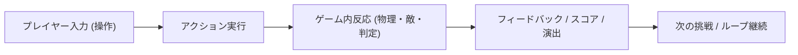

# ゲーム企画・MVP仕様書テンプレート (GDD)

## 1. エグゼクティブサマリー
- **ゲームタイトル**: [タイトル / 仮題]
- **ジャンル**: [2Dアクション / 3Dアクション / パズル / 見下ろし型 など]
- **次元**: [2D または 3D]
- **ターゲット体験**: [プレイヤーに届けたい最大の感情・快感]
- **対象プラットフォーム**: PC (Godot 4.x Forward Plus / D3D12)

---

## 2. コアゲームループ

- **基本操作**:
  - 移動:
  - アクション1:
  - アクション2:
- **勝利条件**:
- **敗北・リトライ条件**:

---

## 3. MVP（Minimum Viable Product）スコープ分割

### フェーズ 1: コアMVP（本セッションで実装・検証）
- [ ] プレイヤーの基本操作（移動、ジャンプ、カメラ）
- [ ] 最小のステージ（床、足場、障害物）
- [ ] コアメカニクス（収集アイテム、敵、またはギミック1種）
- [ ] 最小限のHUD（スコア、操作ガイド）
- [ ] クリア・リセット処理

### フェーズ 2: 拡張要素（MVP検証後に追加）
- [ ] ギミック追加（動く床、トラップ、鍵と扉など）
- [ ] 敵AI（パトロール、追尾）
- [ ] BGM・効果音（SE）

### フェーズ 3: ポリッシュ・演出
- [ ] VFX・シェーダー演出（パーティクル、画面揺れ）
- [ ] タイトル画面・ポーズ画面・リザルト演出

---

## 4. 必要アセット要件リスト

### 2D / 3D アセット
| アセット名 | 種別 | 役割 | 担当スキル |
| :--- | :--- | :--- | :--- |
| Player | 2D Sprite / 3D Model | 操作キャラクター | 2D: image-generator / 3D: blender-asset-creator |
| Stage Object | 2D Tile / 3D Model | 床、壁、足場 | 2D: TileMap / 3D: blender-asset-creator (-col) |
| Collectible | 2D Sprite / 3D Model | 収集アイテム | 2D: image-generator / 3D: blender-asset-creator |

### UI / サウンド
| アセット名 | 種別 | 役割 |
| :--- | :--- | :--- |
| HUD Icons | 2D画像 / Vector | 洗練されたアイコン（絵文字不使用） |
| SE / BGM | Audio | ジャンプ音、取得音、クリア音、BGM |

---

## 5. 後続スキルの自動選択フラグ
- **2D判定の場合**: `godot-2d-specialist` を起動
- **3D判定の場合**: `blender-asset-creator` および `godot-3d-specialist` を起動
- **アート監修**: 必ず `game-art-director` を経由してデザインガイドラインを策定

