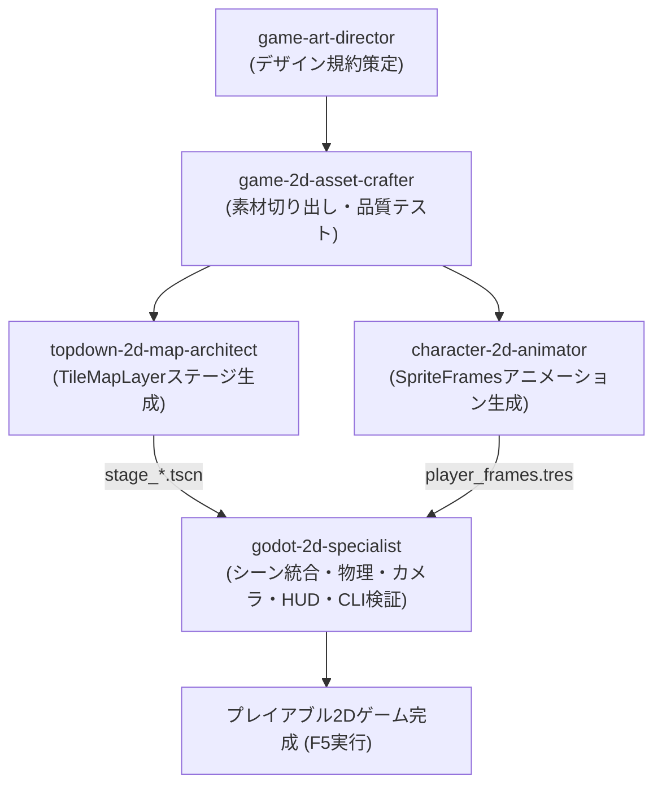

# Godot 2D Specialist (Godot 2D専門開発オーケストレーター)

Godot 4.x（GDScript）における2Dゲーム開発を専門に担当し、物理、ステートマシン、レベルデザイン、UI、CLI自動検証までを自律的に推進するスキルです。

---

## 統合パイプライン連携フロー

---

## ワークフロー

### 1. 仕様 ＆ アート受領（または上流スキル連携）
- `game-spec-architect` の仕様書と `game-art-director` のデザイン規約（絵文字禁止、指定カラーパレット）をインプットにします。
- **素材・ステージが未作成の場合**:
  - `game-2d-asset-crafter` を呼び出してデザイン画像から素材・スプライトを抽出。
  - `topdown-2d-map-architect` を呼び出して `TileMapLayer` ステージシーン（`.tscn`）を生成。
  - `character-2d-animator` を呼び出して 4方向 `SpriteFrames`（`.tres`）を生成。

### 2. サブエージェント分業による実装
- **`2d-logic-specialist`**:
  - `CharacterBody2D` に `character-2d-animator` の `SpriteFrames` をアタッチ。
  - ステートマシン（`references/2d_state_machine.gd`）と4方向入力（Idle, Walk, Dash, Attack, Hurt, Death）を実装。
- **`2d-level-specialist`**:
  - `topdown-2d-map-architect` で生成された `TileMapLayer` ステージシーンをメインシーンに読み込み。
  - プレイヤーのスポーン位置設定、カメラ追従（`Camera2D` スムージング）を構成。
- **`2d-ui-specialist`**:
  - 絵文字を排除した洗練されたテクスチャHUD（ライフバー、スコア、ミニマップ）。
- **`2d-vfx-audio-specialist`**:
  - `CPUParticles2D`（土煙、剣撃火花、ヒットストップ）、オーディオ管理（`references/2d_audio_vfx_manager.gd`）。

### 3. 自律検証（QA）
- `Godot_v4.7.2-stable_win64_console.exe --headless --quit` でパースエラー・読込エラー・未バインドシグナルを検出。
- エラーがあれば即座に自己修復を行い、Exit code 0 を担保します。

### 4. ユーザー節目確認
- 各フェーズの節目で実装内容と起動手順（F5実行）を報告し、ユーザーの承認を得ます。
