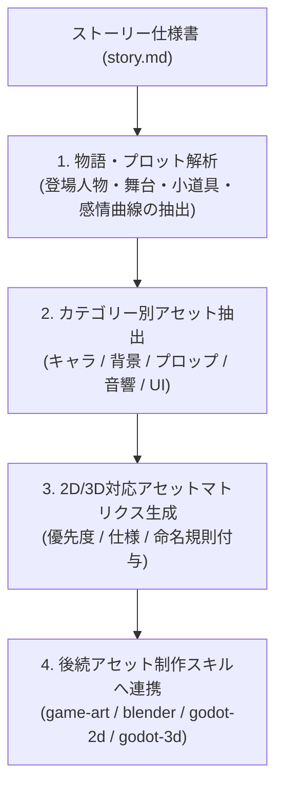

# Story Asset Extractor (ストーリー起点アセット抽出オーケストレーター)

策定されたゲームストーリー（`story.md`）を精密に解析し、ゲーム制作に必要な全アセット（ビジュアル・背景・アイテム・サウンド・UI演出）を網羅的に洗い出し、2Dおよび3Dの制作パイプラインに即したアセット計画書（`assets_plan.md`）を出力するスキルです。

---

## ワークフロー

---

## 素材洗い出しの5大カテゴリー

### 1. キャラクターアセット (Characters)
- **プレイヤーキャラクター**:
  - 待機（Idle）、移動（Run/Walk）、ジャンプ（Jump/Fall）、攻撃、被弾、勝利モーション
- **敵キャラクター（通常敵・中ボス・最終ボス）**:
  - 索敵、接近、攻撃パターン別アニメーション、撃破/消滅エフェクト
- **NPC・マスコット**:
  - 会話待機、ジェスチャー、表情差分（会話ウィンドウ用）

### 2. 環境・背景アセット (Environments)
- **地形・足場**:
  - 2D: TileMapLayer用タイルセット（床、壁、傾斜、天井）
  - 3D: モジュール式地面メッシュ、足場ブロック（`-col` 自動コリジョン付与）
- **背景演出**:
  - 2D: パララックス（多重スクロール）背景レイヤー
  - 3D: スカイボックス、遠景フォグ、ライティング設定（`DirectionalLight3D`, `WorldEnvironment`）
- **ステージギミック**:
  - 動く床、トゲトラップ、施錠扉、スイッチ、昇降リフト

### 3. プロップ・アイテムアセット (Props & Items)
- **キーアイテム**:
  - 物語の進行に必要な重要アイテム（鍵、古代の遺物、巻物など）
- **収集アイテム**:
  - コイン、エネルギーオーブ、スコアアイテム（回転・浮遊アニメーション想定）
- **消耗品・装備品**:
  - ポーション、武器、盾、防具

### 4. サウンド・音響アセット (Audio)
- **BGM (背景音楽)**:
  - タイトル画面、各ステージ（Stage 1〜4）、ボス戦、勝利ファンファーレ、ゲームオーバー
  - ※雰囲気、BPM、使用楽器のトーンを指定
- **効果音 (SE)**:
  - アクション音（足音、ジャンプ、着地、剣の素振り、射撃音）
  - リアクション音（敵ヒット、ダメージ被弾、爆発、消滅）
  - システム音（アイテム取得、扉開閉、ボタン押下、決定/キャンセル）
- **環境音 (Ambience)**:
  - 風の音、雨音、洞窟の滴り、機械の稼働音

### 5. UI・テキスト演出アセット (UI & Effects)
- **会話システム用**:
  - 会話ウィンドウ枠、フォント規格、顔グラフィック枠、ネームプレート
- **HUD（画面情報表示）**:
  - ライフバー/ハート、スコアカウンター、ボスHPバー（絵文字を排除したモダンデザイン）
- **演出用スプラッシュ**:
  - ステージ開始演出（"STAGE 1 START"）、クリアバナー、ゲームオーバー画面

---

## 内蔵サブエージェントと専門領域

- **`asset-visual-extractor`**:
  - 物語の登場人物、舞台、プロップから、ビジュアル・テクスチャ・モデルの形状仕様を抽出。
- **`asset-audio-extractor`**:
  - シーンごとの感情トーン、テンポ、空間音響（2D/3D）に応じたBGM/SE仕様を抽出。
- **`asset-matrix-formatter`**:
  - `references/asset_matrix_template.md` に基づき、優先度（MVP/推奨/追加）、実装担当スキル（`blender-asset-creator`, `godot-2d-specialist`, `godot-3d-specialist`）をマッピングした構造化マトリクスを出力。

---

## 成果物の出力と後続スキルへの引き継ぎ

1. 成果物として `assets_plan.md`（またはアーティファクト）を出力し、ユーザーの確認・承認を得ます。
2. 承認後、制作次元（2Dまたは3D）に応じて後続の専門制作スキルを即座に呼び出します：
   - **ビジュアル規約策定**: `game-art-director`（カラーパレット・UIデザイン基準）
   - **3Dアセット自動生成**: `blender-asset-creator`（Blender Pythonによるモデリング）
   - **ゲーム統合・実装**: `godot-2d-specialist` または `godot-3d-specialist`
