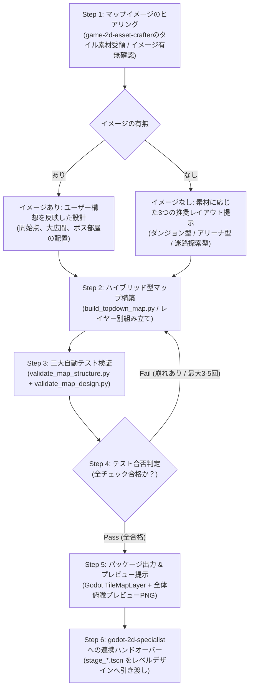

# Topdown 2D Map Architect (マップ・ステージ設計＆自律検証オーケストレーター)

トップダウン2Dゲーム向けに、用意されたタイル素材からステージやマップを自動／半自動設計し、**「構成の崩れ（経路閉塞・孤立）」** と **「デザインの崩れ（タイルの角・境界不整合）」** を徹底的にテスト検証して、問題があれば自律的にやり直して仕上げるスキルです。

---

## ワークフロー概要

---

## ワークフローステップ詳細

### Step 1: マップ・ステージのイメージヒアリング
- `game-2d-asset-crafter` 等からタイル素材群を受け取り、イメージの有無（あり: ユーザー構想 / なし: ダンジョン・アリーナ・迷路の3推奨案から選定）を確認します。

### Step 2: ハイブリッド型マップ構築
- `scripts/build_topdown_map.py` を実行して、マップ構造・衝突判定・装飾レイヤーを組み立てます。

### Step 3: 二大自動テスト検証（崩れ検知）
1. **構成の崩れテスト**: `scripts/validate_map_structure.py` でBFS経路到達性100%（スタート〜ゴール/全宝箱）、外周密閉度、孤立床を検査。
2. **デザインの崩れテスト**: `scripts/validate_map_design.py` で孤立壁、壁内穴あき、オブジェクト埋没を検査。

### Step 4: 改善ループ（反復リトライ）
- 崩れ検知時はエラー箇所を特定し、自動修正して Step 2 を再実行（最大3〜5回）。

### Step 5: パッケージ出力 & 節目確認
- **全体俯瞰プレビュー画像 (`map_preview.png`)** を提示し、ユーザーの承認を得ます（**節目確認 2A**）。
- Godot 4.x シーンファイル (`stage_01.tscn`) をエクスポート。

### Step 6: `godot-2d-specialist` への連携ハンドオーバー
- 承認されたステージシーン（`.tscn`）を **`godot-2d-specialist`** のレベル担当サブエージェント（`2d-level-specialist`）へ引き渡し、メインゲームシーンへのインポートとカメラ追従設定を依頼します。

---

## 付属スクリプト一覧
- **`scripts/build_topdown_map.py`**: ハイブリッド型マップ構築、プレビューPNGレンダリング、Godot TSCNエクスポート
- **`scripts/validate_map_structure.py`**: BFS経路探索、外周密閉度、孤立床検出
- **`scripts/validate_map_design.py`**: 壁接続・穴あき・オブジェクト埋没のデザイン整合性検証
